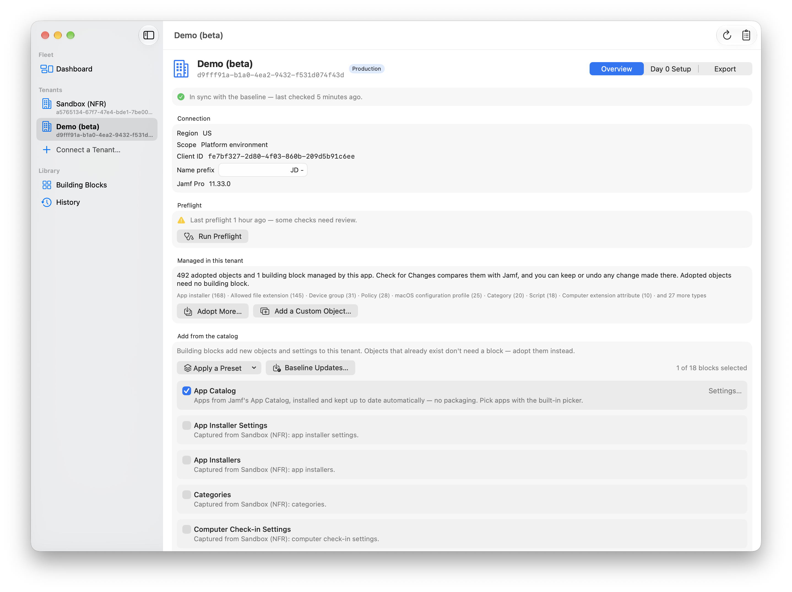
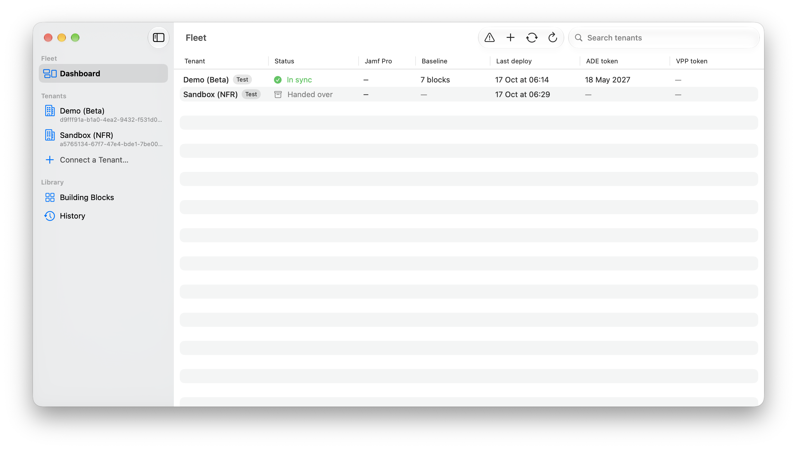

  

# Jamf Deployer

*Best-practice Jamf tenants, deployed and kept that way.*

## What it does

Jamf Deployer is a macOS app for engineers who set up and look after Jamf tenants. It takes a new tenant to a best-practice baseline in an afternoon, captures what already exists in a tenant as reusable configuration, and keeps every tenant honest over time — showing what changed in Jamf outside the app and what a newer baseline would change, before anything is deployed.

Under the hood it drives [OpenTofu](https://opentofu.org) with the official [jamfplatform](https://github.com/jamf/terraform-provider-jamfplatform) and [jamfprotect](https://github.com/Jamf-Concepts/terraform-provider-jamfprotect) providers — all bundled, nothing to install, and no Terraform knowledge needed. Everything is expressed in plain language: baselines are built from **building blocks**, every deploy starts with a **preview of changes**, and nothing is ever applied without your confirmation.

- **Set up** — connect a tenant with Jamf Platform API credentials, pick a preset or compose a baseline from building blocks, preview and deploy. The app ships the configuration-free blocks (App Catalog apps, Jamf Protect, Security Cloud), which use the groups and categories already in your tenant; opinionated ones come from catalogs you publish, with the versioned [demo catalog](https://github.com/JordyThery/jamf-deployer-catalog) (device groups, categories, extension attributes, enrollment, FileVault, software updates, CIS Level 1, Rosetta 2, tenant settings and more) as a worked example and template. A Day 0 checklist covers what an API cannot: APNs, Apple Business Manager tokens, branding.
- **Export** — turn an existing tenant's objects into reusable building blocks that keep their wiring — one export can become several blocks, or a full tenant clone — plus documentation or a point-in-time snapshot; adopt hand-configured objects into management without recreating them.
- **Maintain** — on-demand checks (one tenant, or the whole fleet from the dashboard) show changes made directly in Jamf; keep a change or restore the baseline. Baseline updates are reviewed and opted into per block. Every deploy is recorded with history and rollback.
- **Work as a team** — a shared GitHub repository synchronizes tenants, locks and catalogs across engineers, with credentials shared end-to-end encrypted. See [Team Mode](docs/team-mode.md).

The fleet dashboard keeps every tenant's sync state, baseline size and Apple token expirations on one screen:

## Documentation

- **[Getting Started](docs/getting-started.md)** — installing, connecting the first tenant, the first deploy
- **[Building Blocks](docs/building-blocks.md)** — what each block does, settings and scope, presets, making your own blocks and catalogs
- **[Permissions](docs/permissions.md)** — the API client privileges each block and feature needs, scoped to least privilege
- **[Team Mode](docs/team-mode.md)** — the shared repository, locks, encrypted credential sharing, joining and leaving
- **[Switching to plain Terraform](docs/ejecting.md)** — taking a tenant's configuration and state to a Terraform or OpenTofu workflow; there is no lock-in

## Requirements

- macOS 15 or later, Apple silicon
- A Jamf tenant on the Jamf Platform API gateway, with an API client (and optionally a Jamf Protect API client)
- Team Mode additionally needs a GitHub repository the team can push to, with `git` credentials configured on each Mac

## Security

- **Credentials never touch disk.** API secrets live in your Mac's Keychain and are handed to the deployment engine as environment variables for the duration of a run — never written to configuration, logs or state. Deploy history keeps a copy of each applied plan with every sensitive value masked.
- **Tenant records are encrypted.** The engine's state and plan files are encrypted with a per-tenant passphrase (PBKDF2 + AES-GCM); a recovery sheet is produced at first deploy. Without the passphrase the record is unreadable, including by the app.
- **Nothing deploys without a preview.** The app only ever applies the exact plan you approved; there is no auto-apply.
- **Team sharing is end-to-end encrypted.** Shared credentials are sealed per engineer (Curve25519 + ChaCha20-Poly1305); the repository carries only ciphertext, and private keys never leave each engineer's Keychain.
- The app talks only to your Jamf tenants, your Git remotes (Team Mode and Git catalog sources), GitHub's API for release and component-update checks, and HashiCorp's release server when you agree to the Terraform download for exports.

## Building

Open the project in Xcode 27 or later, run `Vendor/fetch.sh` once to download the engine, providers and jamformer, then build the `Jamf Deployer` scheme. Exporting existing tenants optionally uses HashiCorp Terraform, which the app downloads on first use with your consent (it is BUSL-licensed and never bundled).

## Acknowledgements

Jamf Deployer stands on [OpenTofu](https://opentofu.org) (MPL-2.0), the [jamfplatform](https://github.com/jamf/terraform-provider-jamfplatform) and [jamfprotect](https://github.com/Jamf-Concepts/terraform-provider-jamfprotect) providers (MPL-2.0), and [jamformer](https://github.com/Jamf-Concepts/jamformer). Their licenses accompany the bundled copies.

This is an independent project, not affiliated with or endorsed by Jamf.

## Support

If Jamf Deployer saves you time, you can [buy me a coffee](https://buymeacoffee.com/jordythery). ☕️
