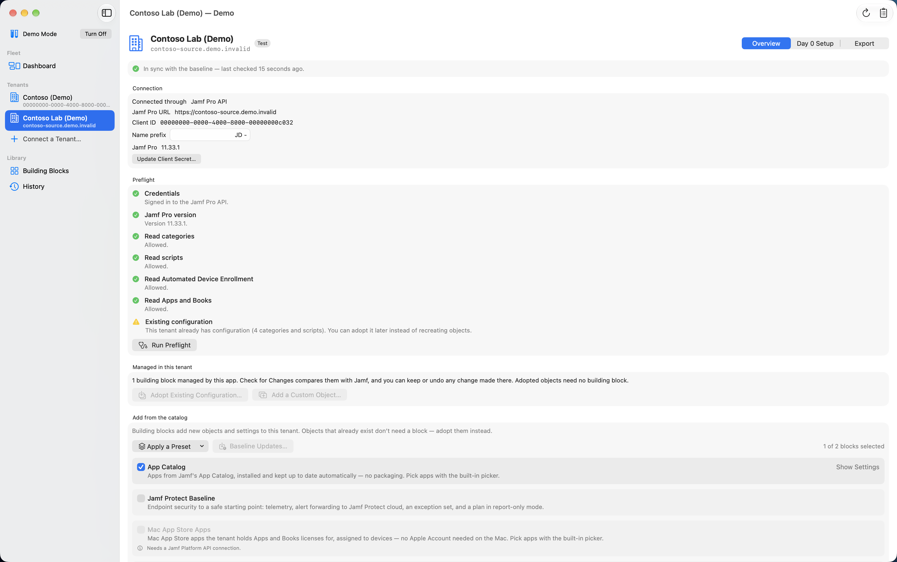
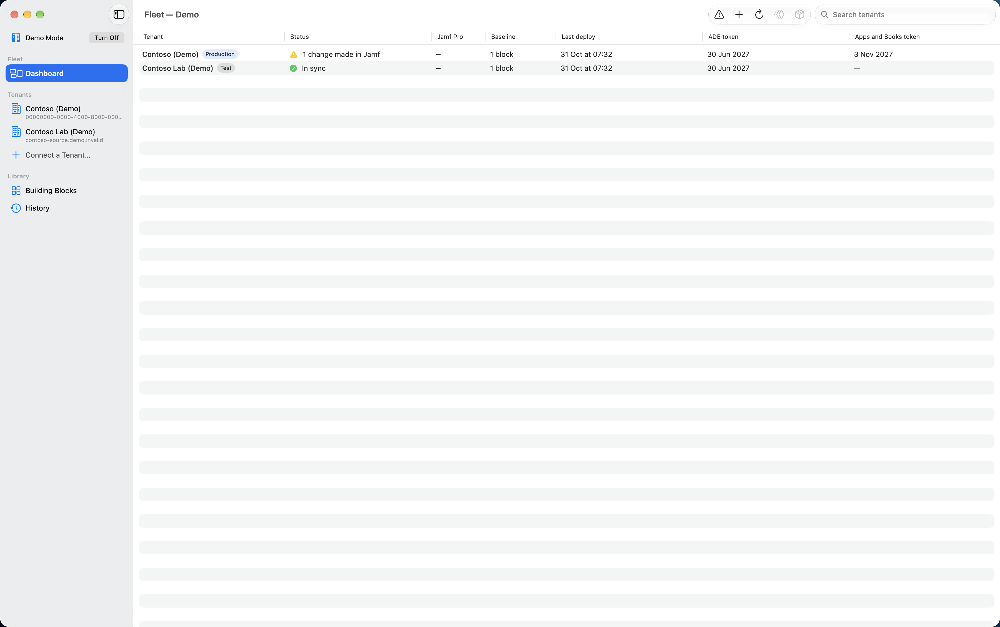

  

# Jamf Deployer

*Best-practice Jamf tenants, deployed and kept that way.*

## What it does

Jamf Deployer is a macOS app for engineers who set up and look after Jamf tenants. It takes a new tenant to a best-practice baseline in an afternoon, captures what already exists in a tenant as reusable configuration, and keeps every tenant honest over time — showing what changed in Jamf outside the app and what a newer baseline would change, before anything is deployed.

Under the hood it drives [OpenTofu](https://opentofu.org) with the official [jamfplatform](https://github.com/jamf/terraform-provider-jamfplatform) and [jamfprotect](https://github.com/Jamf-Concepts/terraform-provider-jamfprotect) providers, plus the community [jamfpro](https://github.com/deploymenttheory/terraform-provider-jamfpro) provider for tenants connected through the Jamf Pro API — all bundled, nothing to install, and no Terraform knowledge needed. Everything is expressed in plain language: baselines are built from **building blocks**, every deploy starts with a **preview of changes**, and nothing is ever applied without your confirmation.

- **Set up** — connect a tenant through the Jamf Platform API or directly through the Jamf Pro API (an API client or a user account), pick a preset or compose a baseline from building blocks, preview and deploy. The app ships the configuration-free blocks (App Catalog apps, App Store apps for Mac and iPad and iPhone, Jamf Protect Baseline, Security Cloud), which use groups and categories already in your tenant or created by another selected block; opinionated ones come from catalogs you publish, with the versioned [demo catalog](https://github.com/JordyThery/jamf-deployer-catalog) (device groups, categories, extension attributes, enrollment, FileVault, software updates, CIS Level 1, Rosetta 2, tenant settings and more) as a worked example and template. Macs, iPads and iPhones are covered. A Day 0 checklist covers what an API can’t: APNs, Apple Business or Apple School Manager tokens, branding.
- **Export** — turn an existing tenant’s objects into reusable building blocks that keep their wiring — one export can become several blocks, or a full tenant clone — plus documentation or a point-in-time snapshot; adopt hand-configured objects into management without recreating them.
- **Maintain** — on-demand checks (one tenant, or the whole fleet from the dashboard) show changes made directly in Jamf; keep a change or restore the baseline. **Baseline Updates…** lists newer releases of a tenant’s blocks, which you opt into block by block, and **Roll Out…** takes a change across the fleet tenant by tenant, test tenants first, with a preview and your approval for each. Every deploy is recorded in History, and **Roll Back…** restores an earlier baseline. Connections are edited and tested in **Settings › Connections**; a tenant the app manages objects in is removed with **Remove Tenant…**, which asks for its name.
- **Work as a team** — a shared GitHub repository synchronizes tenants and catalogs across engineers; engine state lives in the same repository through a standard Git state backend with locking, encrypted with a team passphrase. See [Team Mode](docs/team-mode.md).
- **Graduate to Terraform** — the app is a way in, not a place to stay. Every preview can show the commands and configuration behind it, and run in Terminal with `./plan.sh`; **Export as Terraform…** writes tenants as a plain Terraform repository (a module per block, a folder per tenant, GitHub workflows for reviewed changes, change checks and objects made outside the code) or moves them there for good, with nothing recreated. [Graduating to Terraform](docs/graduating.md) is the path, stage by stage, to running it all without the app.
- **Try it first** — **Demo Mode** (**Tenant › Demo Mode**, or **Try Demo Mode** in an empty sidebar) opens a sample organization’s fleet with sample data. Browse its tenants and baselines, check for changes and preview a deploy; nothing is sent to a tenant, and nothing is deployed. See [Getting Started](docs/getting-started.md#demo-mode).

The fleet dashboard keeps every tenant’s sync state, baseline size and Apple token expirations on one screen:

## Menus and shortcuts

Every action on screen is also in the menu bar:

- **File:** Connect a Tenant… (⌘N), Export as Terraform… (⇧⌘E)
- **View:** Dashboard (⌘1), Building Blocks (⌘2), History (⌘3); a tenant’s Overview, Day 0 Setup and Export (⌥⌘1–3); Show Technical Details; Show or Hide Sidebar
- **Tenant:** Demo Mode; Check for Changes (⌘R), Check All Tenants (⇧⌘R), Preview Changes… (⌘P, where every deploy starts); Adopt Existing Configuration…, Add a Custom Object…, Baseline Updates…, Run Preflight; Update Client Secret…, Hand Over Tenant…, Remove Tenant…; Roll Out…; in Team Mode, Sync Now and Force Unlock…
- **Catalog:** Manage Sources…, Add Git Catalog…
- **Window:** Activity Log (⇧⌘L), every call to Jamf and every engine run as it happens

## Updates and diagnostics

- **Updates:** the app checks its GitHub releases once a day (Settings › Updates, where the daily check can be turned off), and **Check for Updates…** in the app menu checks now. When a newer version exists the app offers it, and downloads come only from the app’s own GitHub releases.
- **Built-in tools:** Settings › Advanced lists the bundled OpenTofu, engine plugins, jamformer and Git state backend with their versions, and flags newer upstream releases (checked once a day). They change only with an app update.
- **Create Support Bundle…** (Settings › Advanced) zips app and tool versions, team-sync status and the Activity Log, with device identifiers, usernames and IP addresses replaced by placeholders. Secrets, tenant records and tenant state are never included.

## Documentation

- **[Getting Started](docs/getting-started.md)** — installing, connecting the first tenant, the first deploy
- **[Building Blocks](docs/building-blocks.md)** — what each block does, settings and scope, presets, making your own blocks and catalogs
- **[Permissions](docs/permissions.md)** — the API client privileges each block and feature needs, scoped to least privilege
- **[Team Mode](docs/team-mode.md)** — the shared repository, state backend and locks, the team passphrase, per-engineer credentials, joining and leaving
- **[Graduating to Terraform](docs/graduating.md)** — the path from the app to running Terraform yourself: reading plans, one tenant on the command line, a Git repository with reviewed changes, and running a fleet. There is no lock-in

## Requirements

- macOS 15 or later, Apple silicon
- A Jamf tenant on the Jamf Platform API gateway, with an API client (and optionally a Jamf Protect API client) — or, without Jamf Platform API access, a Jamf Pro API client or user account
- Git, for the store’s version history and Team Mode: install the Xcode Command Line Tools (`xcode-select --install`)
- Team Mode additionally needs a GitHub repository the team can push to, with Git credentials configured on each Mac

## Security

- **Credentials never touch disk.** API secrets live in your Mac’s Keychain and are handed to the deployment engine as environment variables for the duration of a run — never written to configuration, logs or state. Deploy history keeps a copy of each applied plan, with what the engine marks sensitive and what looks like a secret masked.
- **Deployment state is encrypted.** The engine’s state and plan files are encrypted with a per-tenant passphrase (PBKDF2 + AES-GCM); a recovery sheet is saved before the first deploy. Without the passphrase the state is unreadable, including by the app.
- **Nothing deploys without a preview.** The app only ever applies the exact plan you approved; there is no auto-apply.
- **Team spaces share no credentials.** Each engineer signs in with their own Jamf API client or account, kept in their Keychain. Engine state is encrypted on each Mac with the team passphrase before it reaches the repository.
- The app talks only to your Jamf tenants (including Jamf Cloud’s file storage when a block uploads a package), your Git remotes (Team Mode and Git catalog sources), GitHub (release and component-update checks, and update downloads), the Terraform registry and GitHub while it discovers objects for an export or adoption (to fetch the engine plugin, jamfplatform, jamfpro or jamfprotect, at the version built into the app), and HashiCorp’s release server when you agree to the Terraform download for capturing blocks and adoption.

## Building

Open the project in Xcode 27 or later. Xcode resolves the [JTKit](https://github.com/JordyThery/JTKit) Swift package, the app’s only package dependency, on first open; `Package.resolved` also lists Microsoft’s MSAL, which JTKit depends on and which this app doesn’t link or ship. Run `Vendor/fetch.sh` once to download the engine, providers, jamformer and the Git state backend, then build the `Jamf Deployer` scheme. Capturing blocks from a tenant and adopting existing configuration optionally use HashiCorp Terraform, which the app downloads on first use with your consent (it is BUSL-licensed and never bundled).

## Acknowledgments

Jamf Deployer stands on [OpenTofu](https://opentofu.org) (MPL-2.0), the [jamfplatform](https://github.com/jamf/terraform-provider-jamfplatform) and [jamfprotect](https://github.com/Jamf-Concepts/terraform-provider-jamfprotect) providers (MPL-2.0), the [jamfpro](https://github.com/deploymenttheory/terraform-provider-jamfpro) provider by Deployment Theory (MPL-2.0), [terraform-backend-git](https://github.com/plumber-cd/terraform-backend-git) by plumber-cd (Apache-2.0), and [jamformer](https://github.com/Jamf-Concepts/jamformer) by Jamf Concepts (MIT). Their licenses accompany the bundled copies. The full texts, including those of the libraries compiled into jamformer, are in [THIRD-PARTY-NOTICES.md](THIRD-PARTY-NOTICES.md) and in the app under About Jamf Deployer.

Export as Terraform owes its layout and pipeline to three JNUC 2026 sessions: *Managing the Jamf Platform at Scale With IaC* by Kyle and Neil Martin (Jamf), and *From ClickOps to GitOps: Migrating Jamf Pro at Enterprise Scale to Terraform* and *From Zero to GitOps: Training a Mac Team to Work Like DevOps Engineers* by Joseph, Gordon and Dafydd (Lloyds Banking Group). See [Graduating to Terraform](docs/graduating.md#credits).

## Support

If Jamf Deployer saves you time, you can [buy me a coffee](https://buymeacoffee.com/jordythery). ☕️

## Disclaimer

This tool is provided as-is, without warranty of any kind. Use it at your own risk. This is a personal project. It is not affiliated with or endorsed by my employer or Jamf. Issues and pull requests are appreciated. Support is best-effort.
