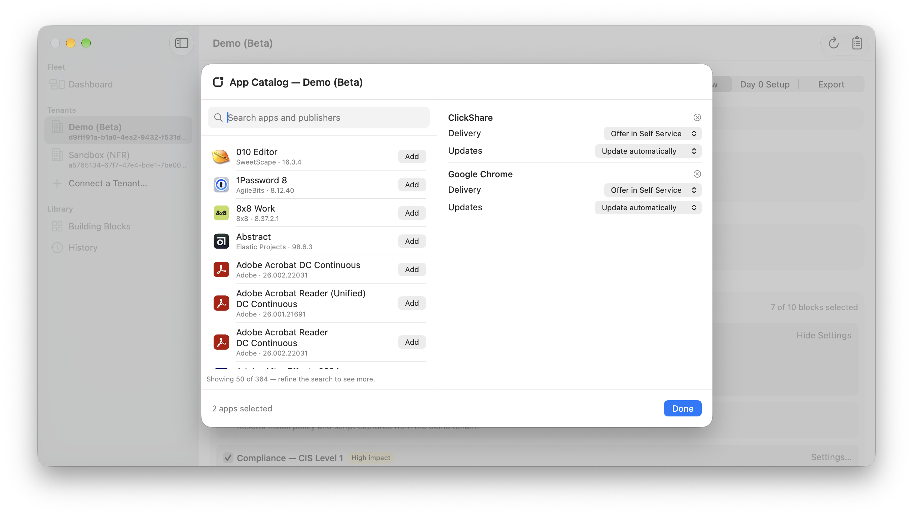
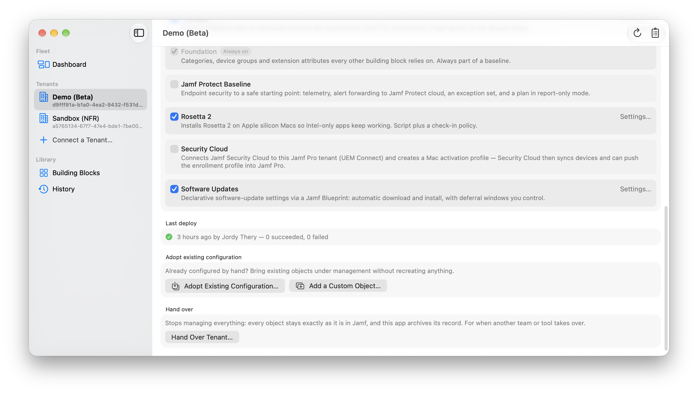

# Building Blocks

A baseline is composed of building blocks. Each block is a self-contained piece of configuration — the objects it creates, the settings you can change, and the device scope it applies to. Blocks declare what they need (products, permissions, other blocks) and the app wires them together.

## Where blocks come from

The app ships the blocks that carry **no configuration opinions of their own** — connector-style blocks you configure entirely yourself, scoped to groups and filed under categories already in your tenant or created by another selected block:

| Built-in block | Creates | Impact |
| --- | --- | --- |
| **App Catalog** | Apps from Jamf's App Catalog, installed and kept up to date automatically — no packaging. Pick apps with the built-in picker. | Medium |
| **Mac App Store Apps** | Mac App Store apps the tenant holds Apps and Books licenses for, assigned to devices — no Apple Account needed. Pick apps with the built-in picker. | Medium |
| **iPad and iPhone Apps** | App Store apps for iPads and iPhones the tenant holds licenses for, assigned to devices as managed apps. | Medium |
| **Jamf Protect Baseline** | Endpoint security to a safe starting point: telemetry, alert forwarding, an exception set, and a plan in report-only mode. Needs a connected Jamf Protect tenant. | High |
| **Security Cloud** | Connects Jamf Security Cloud to the tenant (UEM Connect) and creates a Mac activation profile. Needs a Security Cloud entitlement. | Medium |

Opinionated configuration — what your FileVault, enrollment or update policy should look like — comes from catalogs you follow: capture blocks from a tenant, or publish a catalog repository for your team. Tenants pin the release tag they use, so a published update never changes a tenant until you opt in. The **[demo catalog](https://github.com/JordyThery/jamf-deployer-catalog)** is a worked example and the template for publishing your own.

## The demo catalog

| Block | Creates | Impact |
| --- | --- | --- |
| **Device Groups** | A static Pilot group plus smart groups for all Macs, laptops, desktops and Apple silicon — what the other blocks scope to. | Low |
| **Categories** | Applications, Enrollment, Maintenance and Security. | Low |
| **Extension Attributes** | A Baseline Marker text attribute and a Deployment Ring pop-up (Pilot, Production). | Low |
| **Enrollment** | A computer PreStage for Automated Device Enrollment: supervised, MDM non-removable, consumer setup panes skipped. | Medium |
| **FileVault** | FileVault with an individual recovery key escrowed to Jamf Pro, enforced by a login policy on the chosen scope. | Medium |
| **Software Updates** | Declarative software-update settings via a Jamf Blueprint: automatic download and install, with deferral windows you control. | Medium |
| **Compliance — CIS Level 1** | A compliance benchmark built from the CIS Level 1 baseline. Starts in monitor mode: it reports, it does not change devices. | High |
| **Rosetta 2** | A script plus check-in policy that installs Rosetta 2 on Apple silicon Macs so Intel-only apps keep working. | Low |
| **Check-in & Inventory** | Check-in frequency, whether startup and login run policies, and what inventory Macs report. Tenant-wide setting. | Low |
| **Re-enrollment** | What Jamf Pro clears when a Mac enrolls again, so reused Macs start with a clean record. Tenant-wide setting. | Low |
| **Local Admin Password Rotation** | Rotates managed local admin passwords on a schedule and after each viewing. Tenant-wide setting. | Medium |
| **Self Service App** | Installs Self Service on every Mac; landing page and notifications. Tenant-wide setting. | Low |
| **Self Service Maintenance** | "Update inventory" and "Flush DNS cache" items users run when support asks. | Low |
| **macOS Version Groups** | Smart groups for Macs on the current macOS and Macs below your supported minimum. | Low |
| **Mobile Device Groups** | Smart groups for supervised iPads and supervised iPhones — what the mobile blocks scope to. | Low |
| **Mobile Passcode** | A passcode policy for iPads and iPhones: minimum length, no simple values, automatic lock. | Medium |
| **Mobile Enrollment** | A mobile PreStage for Automated Device Enrollment: supervised, MDM non-removable, consumer setup panes skipped. | Medium |

The App Store blocks list only apps the tenant holds Apps and Books licenses for — every tenant they deploy to needs licenses for the same apps, free apps included. The built-in App Catalog block picks its apps with a searchable picker, with per-app delivery, update behavior and category (an app without its own category uses the block's default category):

## Settings and scope

Every block exposes a small set of plain-language settings — toggles, choices, numbers — defined by the block, not by the underlying provider schema. Secret-typed settings (API keys and similar) are stored in your Keychain, never in the tenant record.

Every block is optional, and blocks connect by reference. A block that applies to devices lets you pick its scope per tenant: a group another selected block creates (for example **Device Groups** from the demo catalog), or a group that already exists in the tenant. Mobile-scoped blocks (iPad and iPhone profiles and apps) pick a mobile device group the same way. Platform-scoped blocks (Software Updates, CIS Level 1) currently offer only groups created by another selected block. Blocks that file objects under a category pick it the same way, or use no category. A block starts on its declared default when the block creating it is selected too — FileVault on Pilot and Security, Rosetta 2 on Apple Silicon Macs — and otherwise asks you to choose, so nothing is created just to satisfy a dependency. Blocks that only support smart groups (App Catalog apps) list only smart groups from the tenant; of the groups another block creates, pick a smart one. Captured blocks that keep their original wiring carry their own scope instead.

In a block's `block.json`, defaults read `"scope": { …, "default": "device-groups/Pilot" }` and `"defaultCategory": "categories/Security"` — the providing block's ID and the object's name from its `provides` list. Presets use the same form in their `scopes` and `categories` maps.

## Removing blocks

Deselecting a block offers two choices. **Remove from Tenant** deletes the block's objects from Jamf on the next deploy — except tenant-wide settings (check-in, re-enrollment, Self Service and similar), which keep their current values because Jamf has no "empty" state for them. **Stop Managing** leaves everything in Jamf untouched and only stops tracking it. Either way the preview shows exactly what will happen.

A tenant-wide setting can belong to one block only: selecting two blocks that manage the same setting stops the preview with a message naming both.

## Presets

Presets come from the catalogs you follow. The demo catalog ships three:

- **Standard** — device groups, categories, extension attributes, enrollment, FileVault, software updates, CIS Level 1 (monitor), Rosetta 2.
- **Minimal** — device groups, categories and software updates; a starting point to grow from.
- **Mobile** — categories, mobile device groups, a passcode policy and a mobile PreStage.
- **Complete** — everything in the demo catalog: Standard plus the tenant settings, Self Service maintenance, macOS version groups and the mobile blocks.

A preset is just a starting selection. Everything stays editable afterwards.

To make your own, compose a tenant's baseline and choose **Apply a Preset → Save Current Baseline as Preset…**. The preset records the blocks, every setting you changed from a block's default, and any scope or category other than the default that points at another block in the preset; groups and categories picked from one tenant are tenant-specific and not saved, and neither are secret settings. It is written to `presets/<name>.json` in a folder catalog source of your choice, so it travels with that catalog — publish the folder as a Git catalog to share presets with a team.

## Baseline updates

Blocks are versioned. When a tenant's catalog source publishes a newer release, **Baseline Updates…** lists what changed per block, and you opt blocks into the newer version individually — each update then goes through the normal preview before it can deploy.

## Making your own blocks

Three ways:

1. **Capture from a tenant.** Export an object (or a set of objects) from any connected tenant; the app turns it into a block and saves it to a catalog source of yours. One export can be captured as a single block or **split into several** — define the blocks, assign each object to one, and the app captures them all from the same export. Captured blocks are marked for review until you approve them. A captured block is meant for *other* tenants: in its origin tenant the objects already exist, so use **Adopt Existing Configuration…** there instead (the editor warns about this).

   Captured blocks **keep their wiring**:

   - A policy keeps its category, scripts, packages and scope groups, and smart groups keep the extension attributes their criteria name. When an export is split, each block declares what it needs from the others; the baseline editor warns when a selected block's dependencies are not covered, and the preview refuses to run until they are.
   - Names that start with the tenant's prefix are parameterized so they follow each tenant's own prefix; a capture option applies the prefix to every object name.
   - PreStage enrollments attach to the deploying tenant's Automated Device Enrollment instance through an editable block setting (the instance name), so the tenant only needs its own ADE token uploaded. PreStages that enable Recovery Lock have it turned off, because Jamf never exports the password.
   - Objects that cannot move between tenants are left out automatically, each with a warning that says why: Self Service icons, enrollment invitations, Jamf's built-in All Managed groups, default allowed file extensions, the cloud distribution point, Jamf Patch reporting attributes, compliance benchmarks, values Jamf does not export (activation code, GSX and volume purchasing tokens) and a login page without disclaimer text.
   - Settings-style types (check-in, re-enrollment, Self Service and the like) can be exported on their own or together with anything else.
   - **Choose scope and category per tenant (portable block)** replaces the captured groups and categories with a scope and category you pick on each tenant; scripts, packages and extension attributes stay wired between blocks either way. For iPad and iPhone objects the scope becomes a mobile device group; an export that scopes both computers and mobile devices keeps the mobile groups as captured (capture them as a separate block to choose both).
   - PreStages keep their enrollment customization when it is part of the export; otherwise they deploy without one, with a warning. Jamf's own Device Compliance group is looked up by name like the All Managed groups.
   - Catalogs can contain blocks written for a newer version of the app; those are listed as unavailable instead of preventing the rest of the catalog from loading.

2. **Duplicate a built-in.** Built-in blocks are read-only — they ship inside the app and update with it. **Duplicate to My Blocks…** in a block's detail view copies it into one of your sources under a new ID, where everything is editable.
3. **Author by hand.** A block is a folder with a `block.json` manifest (identity, settings, scope options, drift bindings) and the OpenTofu module that implements it. The built-in catalog in [`Catalog/blocks`](../Catalog/blocks) is the reference for the format.

Custom blocks are managed from their detail view: edit the name, summary and version in place, reveal the folder in Finder for deeper changes, or delete the block (the app warns when tenants still select it). Sources themselves are managed under **Manage Sources…** in the library's toolbar: **Add Folder…** uses a new or existing folder for your own blocks and presets, **Add Git Catalog…** follows a published catalog, and **Remove…** detaches a source without deleting anything.

## Catalog sources

Blocks come from catalog sources. Besides the built-in catalog:

- **Local folder** — a folder of blocks on disk (where captured blocks land). Always used at its current content.
- **Git repository** — a repository of blocks, pinned by release tag. Tenants record the tag they use, so a published update never changes a tenant until you opt in. This is the way to share a catalog across a team or publish one publicly.

On conflicting block IDs the built-in catalog always wins; custom blocks are used only where a tenant explicitly selects them.
