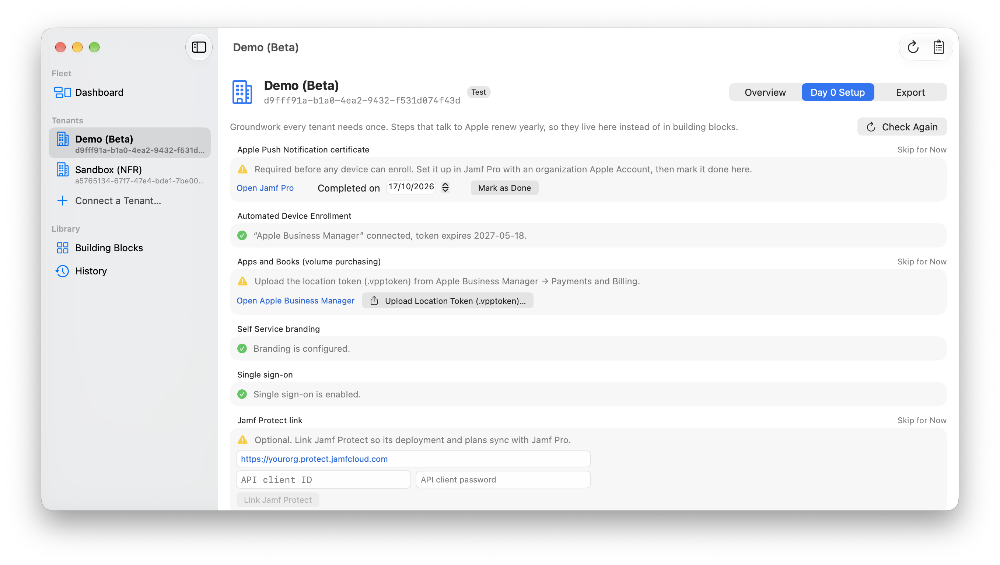

# Getting Started

From download to a deployed baseline in four steps.

## 1. Install

Download the latest release from the [releases page](https://github.com/JordyThery/jamf-deployer/releases/latest), unzip it and drag **Jamf Deployer** to Applications. The app is signed and notarized; everything it needs is inside.

On first launch a guided tour points out the main areas. Revisit it any time from **Help → Guided Tour**.

## 2. Connect a tenant

You need an API integration for the Jamf Platform API gateway:

1. In Jamf Account, create an API integration scoped to the tenant's Platform environment and note the **client ID** and **client secret**. The wizard lists the permissions to grant (see [Permissions](permissions.md)).
2. In Jamf Deployer, click **Connect a Tenant…** and enter a display name, the region (US, EU or APAC), whether it is a test tenant, and the credentials. **Fetch Environments from Jamf Account** looks up the environment ID for organization-scope integrations; otherwise paste it. Older integrations scoped to a single tenant use **Integration uses legacy tenant scope**.
3. The wizard runs a preflight — credentials, Jamf Pro version, read permissions, Automated Device Enrollment and Apps and Books token expiry, and the Cloud Services Connection — and names anything missing before you save. You can still add the tenant and fix permissions later.

The client secret goes straight into your Keychain. It is never written to a file. To enter a rotated secret later, use **Update Client Secret…** (**Update Password…** for a Jamf Pro user account) in the tenant's Connection section.

**No Platform API access yet?** Choose **Connect through: Jamf Pro API** on the wizard's first step and sign in to the Jamf Pro instance directly, with an API client (recommended) or a user account. Such tenants work like any other: building blocks and presets, Adopt, Check for Changes, keep or restore, Add a Custom Object, Roll Out, snapshots, as-built documentation, Day 0 and Hand Over. A few blocks need the Jamf Platform API — Software Updates (a Blueprint), CIS Level 1 (a compliance benchmark), Security Cloud and the App Store blocks — and so do capturing blocks and cloning; presets leave those blocks out with a note. Changes run one at a time over the Jamf Pro API, so large deploys take longer. The connection type is fixed per tenant; to move a tenant to the Platform API later, hand it over, connect it again with Jamf Platform API credentials and adopt its objects. This connection uses the community [jamfpro](https://github.com/deploymenttheory/terraform-provider-jamfpro) engine plugin by Deployment Theory, bundled with the app.

Connecting Jamf Protect (for the Protect building blocks) is an optional wizard step for Jamf Platform API tenants, or later from the tenant's **Day 0 Setup** tab: enter the Protect console URL, API client ID and secret, then **Link Jamf Protect**. This also registers Jamf Pro with Protect.

## 3. Compose a baseline

First visit to **Building Blocks**: the app ships only the configuration-free blocks (App Catalog, Mac App Store Apps, iPad and iPhone Apps, Jamf Protect Baseline, Security Cloud) — add the **[demo catalog](https://github.com/JordyThery/jamf-deployer-catalog)** to try a full baseline (device groups, categories, extension attributes, enrollment, FileVault, software updates, CIS Level 1, Rosetta 2, tenant settings, Self Service maintenance and macOS version groups — versioned by release tag). For real fleets, capture your own blocks or publish your own catalog — the demo repository is the template.

Then compose the baseline in the tenant's **Overview** tab, under **Add from the catalog**:

- Start from a preset offered by your catalog — the demo catalog ships **Standard** (device groups, categories, extension attributes, enrollment, FileVault, software updates, CIS Level 1 monitoring, Rosetta 2), **Minimal**, **Mobile** (iPads and iPhones) and **Complete** — or pick blocks individually.
- Each block has plain-language settings and, where it applies to devices, a scope: a group another selected block creates (the demo catalog's **Device Groups**: Pilot, All Managed Macs, Laptops, Desktops, Apple Silicon Macs) or a group already in the tenant. Blocks that file objects under a category pick one the same way. A block starts on its declared default when the block creating it is selected — FileVault on Pilot, for example — and otherwise asks you to choose.
- Blocks marked high impact (compliance, endpoint security) start in monitor or report-only mode.

See [Building Blocks](building-blocks.md) for what each block creates.

## 4. Preview and deploy

Click **Preview Changes** (⌘P). The app generates the configuration, compares it with the tenant, and lists every object it would add, change or remove — grouped by block, with field-level detail. Nothing has happened to the tenant yet.

Before the first deploy, the app asks you to save a **recovery sheet** (**Save Recovery Sheet…**) with the passphrase that encrypts this tenant's records — store it somewhere safe.

If the preview looks right, click **Deploy**. Only the previewed plan is applied; if anything changed in between, the deploy stops. On a production tenant, a deploy that removes or replaces objects asks you to type the tenant name first. If Jamf reports a server error for an object it actually created, the app finds it by name after the deploy, and the next preview adopts it instead of creating a duplicate.

Every deploy is recorded in **History** (sidebar). **Roll Back…** restores the baseline of an earlier deploy, which you then preview and deploy.

## Day 0 checklist

The **Day 0 Setup** tab tracks the things an API cannot fully do — APNs certificate, Automated Device Enrollment and Apps and Books tokens, branding, single sign-on, the Jamf Protect link and the Cloud Services Connection — with live status where Jamf exposes it and links to the right console pages where it does not.

## From here

- **Check for Changes** (⌘R) shows what was changed directly in Jamf since the last deploy — keep each change or restore the baseline. **Check All Tenants** on the dashboard does the same for the whole fleet. To stop managing a block's objects without touching Jamf, use **Stop Managing** in the baseline. **Hand Over Tenant…** does that for everything — blocks and adopted objects — when another team or tool takes over: confirm with the tenant name to prepare it, review it with **Preview Hand-Over…** and deploy, or use **Cancel Hand-Over** to restore the baseline. Once deployed, the record is archived.
- **Roll Out…** on the dashboard deploys to several tenants one at a time. Choose each tenant's current baseline or the latest release of a Git catalog, then put tenants in rings (test tenants start in ring 1). Every tenant still shows its own preview and waits for you to click Deploy. The rollout stops when a deploy has problems, can pause before each new ring, and ends with a summary. A tenant you skip keeps its current catalog release.
- The **Export** tab has four types: **Building block** (capture objects as a reusable block), **Full snapshot** (**Save Snapshot…** writes a zip of the exported configuration with a `manifest.json` of tenant, date and tool versions), **As-built documentation** (Markdown) and **Clone to tenant** (**Stage Clone** stages the objects on another connected tenant, which then previews and deploys them). Exports read Jamf Pro and Platform or Jamf Protect and never change the tenant. **Adopt Existing Configuration…** (under **Managed in this tenant** on the tenant's Overview) brings hand-configured objects under management without recreating them. Adopted objects are managed as they are — Check for Changes covers them and they need no building block; building blocks are for adding what isn't there yet. **Adopt More…** adds objects later and leaves those already adopted untouched. **Add a Custom Object…** creates an object no block covers yet, from a form built from the provider schema.
- Everyday tools: the **Activity Log** window (⌘⇧L) lists every call the app makes; **Needs Attention** on the dashboard filters to tenants with problems; **Remove Tenant…** (right-click a tenant in the sidebar) removes it from this Mac without touching Jamf; **Settings** holds your engineer name, technical details and **Create Support Bundle…**.
- Working with colleagues? Set up a shared repository: [Team Mode](team-mode.md).
