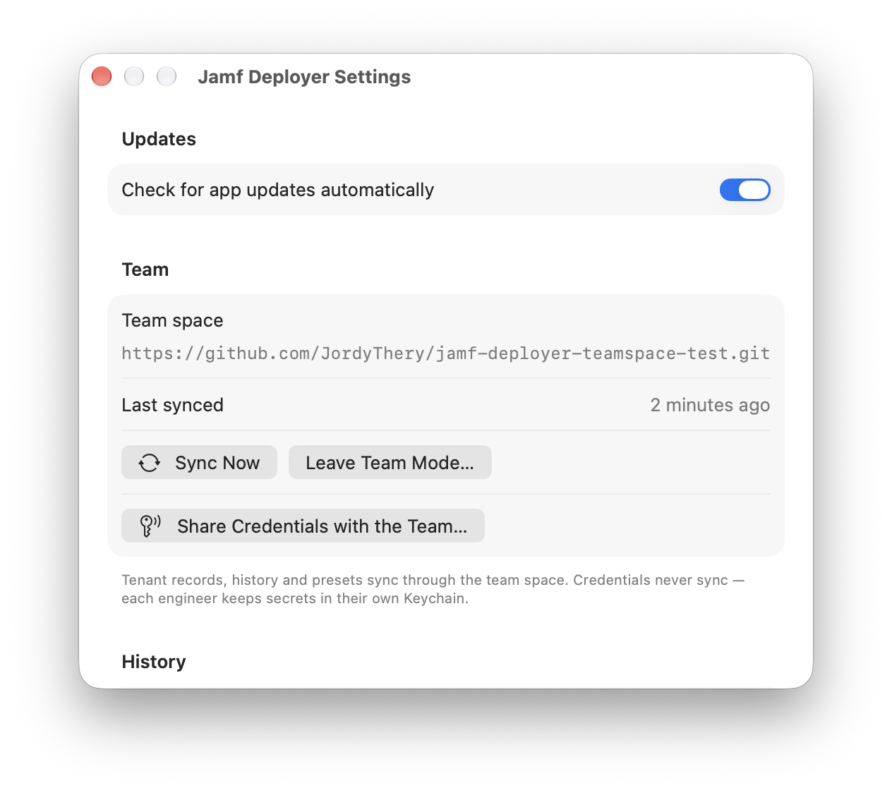

# Team Mode

Team Mode lets several engineers manage the same tenants from their own Macs, synchronized through a GitHub repository. Solo installs already keep everything in a local Git repository, so switching over is a remote away — nothing is restructured.

## How it works

The app's store — tenant records, encrypted state, history and the list of catalog sources — is one Git repository. Block contents travel through Git catalog sources, not the store. In Team Mode that repository has a remote on GitHub:

- **Before a tenant operation** (preview, deploy, drift check) the app pulls, takes a lock on the tenant, and works on the fresh copy.
- **After the operation** it commits the result with a readable message ("Deploy Acme: 3 added · 1 changed · 0 removed · 0 failed — Jordy"), pushes, and releases the lock.
- **Locks** are files under `locks/`, acquired through Git's own push atomicity: whoever pushes the lock first holds the tenant; everyone else sees who, on which Mac, since when. A stale lock can be broken from the tenant view.

Everything in the repository is reviewable: tenant records are JSON, history is JSON, state is encrypted but versioned.

## What is — and is not — in the repository

| In the repository | Never in the repository |
| --- | --- |
| Tenant records (names, selected blocks, settings, scope) | API client secrets |
| Engine state — **encrypted** (AES-GCM, per-tenant passphrase) | State passphrases, in the clear |
| History, including a readable copy of each applied plan with every sensitive value masked | Secret-typed block settings |
| Adopted configuration, the list of catalog sources | Private encryption keys |
| Credential envelopes — **end-to-end encrypted** | |

Anyone with repository access can see tenant names, structure and encrypted state, so scope repository access accordingly.

## Sharing credentials, end-to-end encrypted

So a teammate can work on a tenant without re-entering its credentials:

1. The first time an engineer runs **Share Credentials with the Team…**, the app creates their Curve25519 identity. The private key stays in their Keychain; only the public key is published to the repository (`team/engineers/`).
2. The same action seals each tenant's Platform API secret, Jamf Protect secret and state passphrase once per published engineer (X25519 key agreement → HKDF-SHA256 → ChaCha20-Poly1305) into `team/secrets/`. The repository only ever carries ciphertext. Secret-typed block settings are not shared — each engineer enters those on their own Mac.
3. On sync, each Mac decrypts the envelopes addressed to it and stores the secrets in its own Keychain.

A new engineer runs **Share Credentials with the Team…** once to publish their key; an existing member then runs it again to grant them access. GitHub never sees a usable secret.

## Setting up

**Create** (first engineer): Settings → Team → enter the URL of an empty private GitHub repository under **Repository URL** → **Create Team Space…**. The app zips a backup of the local store first, then pushes it as-is.

**Join** (everyone else): Settings → Team → enter the repository URL → **Join Team Space…**. Local tenants the team space doesn't know yet are copied in; tenants with the same ID are skipped, never overwritten. The team's settings — including its list of catalog sources — replace this Mac's (a backup is kept). Ask a teammate to share credentials, then you're fully operational.

**Leave**: Settings → Team → **Leave Team Mode…**. This Mac keeps a full local copy with history and stops syncing; the team space itself is untouched.

## Requirements and caveats

- Each Mac needs push access with Git credentials already configured (SSH key or `gh auth login`); the app never prompts for Git passwords.
- Locks don't expire on their own — the holder, host and age are always shown, and **Break Lock** is available when a Mac went away mid-operation.
- Two operations on the same tenant from the same Mac are serialized by the engine itself.
